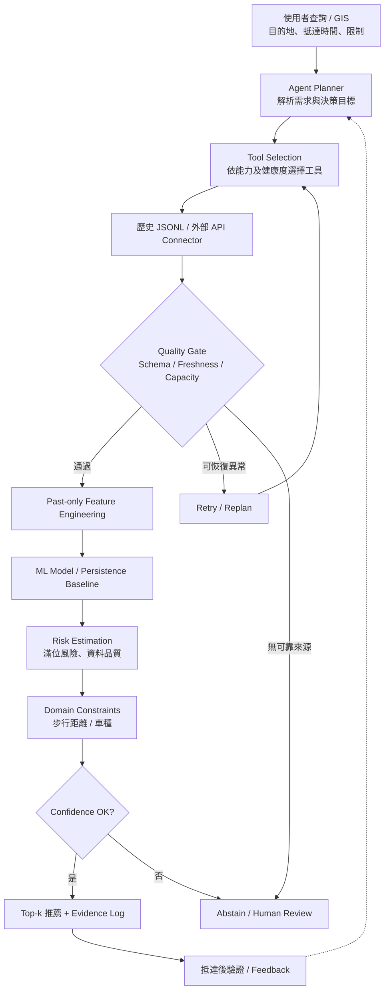

# 智慧停車 AI Agent｜新北市路邊停車可用性預測與風險感知推薦

**Smart Parking AI Agent for On-Street Parking Availability Prediction and Risk-Aware Recommendation in New Taipei City**

> 國立中興大學 資訊科學與工程學系｜物聯網應用與資料分析  
> 2026 年 11 月｜期中／期末專題提案（Project Proposal）

**專案狀態：Proposal / Prototype** — 已取得部分新北市路邊停車歷史資料並進行抽樣預測測試；新北市全量資料檢驗、正式預測與推薦成效仍待驗證。

## 目錄

- [一、研究背景與動機](#一研究背景與動機)
- [二、研究目標與問題定義](#二研究目標與問題定義)
- [三、研究資料與目前成果](#三研究資料與目前成果)
- [四、系統架構與 AI Agent 工作流程](#四系統架構與-ai-agent-工作流程)
- [五、預測模型與推薦策略](#五預測模型與推薦策略)
- [六、研究假設與評估方式](#六研究假設與評估方式)
- [七、目前進度與期末規劃](#七目前進度與期末規劃)
- [八、預計專案結構](#八預計專案結構)
- [九、技術與研究限制](#九技術與研究限制)
- [十、參考文獻](#十參考文獻)

## 一、研究背景與動機

現有停車資訊通常提供**查詢當下**的剩餘停車格數，然而駕駛從查詢、導航到抵達目的地需要時間，因此：

**「現在有空位」不代表「抵達時還有空位」。**

尤其尖峰時段停車供需變化快速，單看即時空位可能造成反覆繞行、額外搜尋時間與不必要的道路壅塞。本專題以**新北市路邊停車路段**為主要研究對象，嘗試將單純資訊顯示轉換為**抵達時間導向的可用性預測與風險感知推薦**。

本研究亦考量資料延遲、API 逾時、異常資料及模型信心不足等真實情境；當可靠證據不足時，系統應選擇重新規劃、使用替代來源，或明確表示無法可靠推薦，而非強行給出結果。

## 二、研究目標與問題定義

### 2.1 研究目標

1. **抵達時間預測**：根據使用者指定的未來日期、時段與預估抵達時間，預測候選路段剩餘車位。
2. **資料品質感知**：驗證資料格式、時間戳、重複紀錄、更新時效與容量合理性。
3. **風險感知推薦**：結合預估車位、滿位風險、步行距離與使用者限制，產出可解釋的 **Top-k** 候選路段。
4. **Agent 自主決策**：依資料與工具健康狀態選擇來源；對可恢復異常進行 Retry／Replan，對無法確認的情況進行 Abstain／Human Review。
5. **實證驗證**：比較簡單 Baseline、機器學習模型，以及 AI Agent 與固定 Pipeline 的實際效益。

### 2.2 系統輸入與輸出

| 類別 | 內容 |
| --- | --- |
| 輸入 | 目的地、預計抵達日期與時間、可接受步行距離、車種及偏好 |
| 預測結果 | 候選路段預估剩餘格數、滿位風險 |
| 推薦結果 | Top-k 路段、排序依據、距離與限制 |
| 可追溯資訊 | 資料來源、觀測時間、資料品質、模型及錯誤／不確定性說明 |
| 例外處理 | Retry、Replan、使用替代資料源、Abstain 或 Human Review |

**研究範圍：** 本階段聚焦新北市**路邊停車路段**；路外停車場、跨城市整合與正式上線部署列為後續擴充方向，不宣稱已完成。

## 三、研究資料與目前成果

### 3.1 新北市路邊停車歷史資料

| 項目 | 目前狀態 |
| --- | --- |
| 研究區域 | 新北市 |
| 觀測單位 | 路邊停車路段 |
| 歷史資料格式 | JSONL |
| 已取得資料日期 | **2025/05/01–2026/11/02** |
| 來源 | 提案文件所述之新北市路邊停車歷史資料（TDX 相關服務） |
| 實際紀錄數／路段數 | **待全量資料品質分析** |
| 真正時間解析度／更新間隔 | **待由原始時間戳確認** |
| Schema 與容量欄位語意 | **待確認** |

歷史資料候選主鍵設計：

```text
(source, segment_id, observed_at)
```

以上為**邏輯欄位名稱**，必須在檢視實際 JSONL Schema 後映射與驗證，不預設原始資料必然使用相同欄位名稱。

預定品質檢查包括：

- Schema、日期格式與時區一致性
- 缺值、重複紀錄、異常／過期時間戳
- 路段識別、容量與剩餘車位合理性
- 路段覆蓋率、觀測間隔、資料缺口
- 資料來源與擷取時間的可追溯性

> **重要限制：** 不預設上述 JSONL 是即時更新，亦不假設每 10 分鐘都有一筆觀測；須待實際時間序列 QA 後決定可支援的預測時距（forecast horizon）。

### 3.2 已有預測原型

提案文件記錄：現有**抽樣預測 Notebook** 的測試 MAE 約為 **7.12 格**，但此數值存在以下限制：

- 使用 **30 分鐘時段特徵**，不等同已驗證真正的 10 分鐘預測。
- 尚未將**路段 ID** 納入模型特徵。
- 尚未完成新北市全量資料 QA、正式時間切分與跨路段評估。

因此，**MAE ≈ 7.12 僅是既有抽樣原型結果，並非本專題正式模型績效或期末達標證據**。

### 3.3 外部參考資料

[UCI Parking Birmingham Dataset](https://archive.ics.uci.edu/dataset/482/parking+birmingham) 用作資料品質檢查方法與原型參考。這是**不同城市、不同觀測單位的舊資料**，不會直接當作新北市路邊停車預測的有效性證據。

## 四、系統架構與 AI Agent 工作流程

### 4.1 系統架構（Proposed Architecture）



### 4.2 AI Agent 的必要性

固定 Pipeline 適合來源穩定且工作流程固定的情境。此研究則需要根據查詢、路段與資料狀態動態決策：

- **Plan**：解析使用者需求、成功條件與資料需求。
- **Select**：選取合適資料源、模型與工具。
- **Validate**：確認 Schema、觀測時間、資料新鮮度、容量與有效性。
- **Predict**：選用已驗證模型或 Persistence Baseline。
- **Decide**：根據每筆候選的個別資料品質計算風險與推薦順序。
- **Explain**：附上來源、時間戳、限制與 Evidence Log。
- **Verify**：比較抵達時合法觀測，回饋至後續流程。

發生 API Timeout 或資料過期時，Agent 先判斷是否可 Retry／Replan；若沒有可靠替代來源，則 **Abstain**，避免產出沒有依據的建議。

> Agent 是否優於較簡單的固定 Pipeline，仍需透過實驗驗證，並非預設成立。

### 4.3 核心演算法（概念性 Pseudocode）

```text
Input : UserQuery Q, ToolRegistry T, MaxReplans K
Output: Top-k Recommendations OR Abstain/HumanReview

plan <- Planner(Q, T)
while plan has task:
    tool <- SelectTool(plan, T.health)
    try:
        raw <- tool.Call()
    except retryable_error:
        LogEvidence(error)
        if replan_count < K:
            plan <- Replan(plan, error)
            continue
        return HumanReview(error)

    observations <- ValidateSchemaTimeCapacity(raw)
    if observations is empty:
        if AlternativeToolExists(T):
            plan <- Replan(plan, "quality_failure")
            continue
        return Abstain("no reliable data")

    for each observation o:
        features <- BuildPastOnlyFeatures(o, Q.arrival_time)
        model <- SelectValidatedModel(Q.horizon)
        forecast <- ModelOrPersistence(model, features)
        forecast <- ApplyCapacityBounds(forecast, o.total_spaces)
        risk <- EstimateFullRisk(forecast, o.quality)
        StoreCandidate(forecast, risk, evidence=o)

    recommendations <- ApplyConstraintsAndRankTopK(Q)
    if LowConfidence(recommendations):
        return HumanReview(recommendations.evidence)

    LogEvidence(recommendations)
    return recommendations
```

**關鍵防錯規則：** 每筆候選預測應使用自己的 `observation.quality`，避免將某一路段的資料品質錯誤套用到所有候選。

## 五、預測模型與推薦策略

### 5.1 Baseline 與候選模型

| 方法 | 用途 | 階段 |
| --- | --- | --- |
| Persistence | 假設未來值維持近期已知剩餘格數 | 原型／比較基準 |
| Historical Median | 依同星期、同時段歷史中位數預測 | 規劃比較 |
| Random Forest | 學習非線性時間與路段特徵 | 規劃驗證 |
| HistGradientBoosting | 建立樹模型預測基準 | 規劃驗證 |
| LSTM / Transformer | 資料充分且基準模型驗證後再評估 | 後續候選 |

預計特徵包含**路段識別、時間／星期、歷史 lag／rolling 統計、容量**，以及在預測當下已能合法取得的外部資訊。**所有特徵僅能使用預測 cutoff 前已知資料**，避免 Data Leakage。

### 5.2 風險感知 Top-k 推薦

不僅按距離最近排序，也評估：

- 抵達時預測剩餘車位
- **滿位風險（Full-occupancy Risk）**
- 步行距離及車種限制
- 資料來源時效、品質與預測信心
- 模型預測可追溯證據

滿位事件定義為：**抵達時合法觀測的 `available_spaces = 0`**。風險機率是否可靠，須經校準與獨立測試後確認。

## 六、研究假設與評估方式

### 6.1 研究假設

| 假設 | 待驗證內容 |
| --- | --- |
| **H1** | 加入路段及合法歷史特徵的樹模型，MAE 優於 Persistence |
| **H2** | 以校準後滿位風險排序，提高 Top-3 抵達時至少一處可停的比例 |
| **H3** | 資料品質感知 Agent 在 API 失敗／資料過期時，較固定 Pipeline 減少無依據建議 |

**H1–H3 皆為 Planned / Unverified，不代表已驗證成功。**

### 6.2 資料切分與指標

採用依時間排序的資料切分：

```text
Train (60%)  | Validation (20%) | Test (20%)
─────────────┴──────────────────┴───────────→ Time
```

相同時間群組或重複觀測不得跨組洩漏；測試集應在模型與門檻確定後才正式使用。

| 評估面向 | 指標 |
| --- | --- |
| 車位數量預測 | MAE、RMSE |
| 滿位事件辨識 | Recall、Precision、PR-AUC |
| 風險機率校準 | Brier Score、ECE、Reliability Diagram |
| 推薦有效性 | Top-k Success、MRR、Coverage、步行距離 |
| Agent 異常處理 | 有效建議率、錯誤建議率、Abstention Rate |
| 系統效能 | p95 Response Latency |

抵達時間的 Ground Truth 應取**預定抵達時間後容許窗內第一筆合法觀測**；若無符合條件的觀測，標記為 Missing，不任意以過遠的資料填補。

### 6.3 預設 Go / No-Go 條件

| 目標 | 判定門檻（尚未驗證） |
| --- | --- |
| 資料品質 | 完成新北市全量 JSONL Schema、時間、路段覆蓋 QA |
| 預測精度 | MAE 相較 Persistence 改善 **≥ 5%** |
| 滿位風險 | Recall **≥ 0.80**（目標） |
| 推薦成果 | Top-3 Success 相較純距離排序提升 **≥ 5 個百分點** |
| 風險校準 | 校準後 Brier Score 改善 |
| 回應效能 | p95 **≤ 3 秒** |

若資料覆蓋不足或模型未達目標，將縮小至資料充分的路段、採用 Baseline／歷史趨勢展示，必要時不輸出自動推薦。

## 七、目前進度與期末規劃

| 工作項目 | 提案所記錄的現況 | 下一步 |
| --- | --- | --- |
| 系統研究與提案 | ✅ 架構、研究假設與評估計畫已提出 | 根據實驗修正設計 |
| 新北市歷史 JSONL | ✅ 已取得指定期間資料 | 完成全量 Schema 與 Coverage QA |
| 抽樣預測 Notebook | ✅ 既有測試 MAE 約 7.12 格 | 加入路段 ID、重新驗證各時距 |
| Connector / Quality / Baseline / Agent 原型 | ✅ 提案記錄已實作 | 與新北市實際資料及模型整合 |
| 原型自動化測試 | ✅ 提案記錄既有 9 項通過 | 增加真實資料與失敗案例測試 |
| 正式模型訓練與 H1–H3 驗證 | ⏳ 未完成 | 完成時間切分與消融實驗 |
| Top-k 風險推薦與校準 | ⏳ 未完成 | 比較純距離排序與風險排序 |
| GIS Web Demo | ⏳ 規劃中 | 串接推薦、展示地圖與來源證據 |
| 線上延遲與穩定性 | ⏳ 未驗證 | 測試 p95、API 失敗與 Replan |

> **註：** 此表中的「已實作／已測試」依據提案文件所描述的既有原型。此儲存庫內容將依實際上傳的程式碼逐步同步；README 不代表所有列出的原型檔案都已經存在於本 Repository。

## 八、預計專案結構

以下是**預定整理方向**，不是目前儲存庫已存在的檔案清單：

```text
20261111-DIC3/
├── README.md
├── docs/
│   ├── Design.md                 # 系統設計、決策流程與研究方法（規劃）
│   └── proposal/                 # 期中提案及簡報（規劃）
├── src/
│   ├── connectors/
│   │   └── http_json.py          # API Connector 原型（待同步）
│   ├── preprocessing/
│   │   └── quality.py            # Schema / Freshness / Capacity（待同步）
│   ├── prediction/
│   │   └── baseline.py           # Persistence Baseline（待同步）
│   └── agent/
│       └── orchestrator.py       # Agent Retry / Replan / Evidence（待同步）
├── tools/
│   └── analyze_uci.py            # UCI 品質分析（待同步）
├── notebooks/                    # 新北抽樣預測 Notebook（待同步）
├── tests/                        # 原型自動化測試（待同步）
└── data/
    └── README.md                 # 資料格式、來源與授權說明（規劃）
```

既有原型文件所記錄的測試方式如下；**須待程式碼與依賴套件上傳後才可在此儲存庫執行**：

```bash
python -m unittest discover -s tests -v
```

資料檔可能具有再散布限制、檔案過大或包含來源使用條款；上傳前須確認權利，建議在版本庫記錄**Schema、取得方式與可重現處理程式**，不直接提交未確認授權的大型歷史原始資料。

## 九、技術與研究限制

1. 新北市歷史 JSONL 的全量品質、實際路段數與資料更新間隔尚未統計。
2. 目前抽樣模型缺少路段 ID，且 30 分鐘時段特徵不等同已驗證 10 分鐘的預測效能。
3. 即時 API 的可用性與更新頻率須個別確認，不能假設與歷史 JSONL 相同。
4. 歷史 Ground Truth 的時間容許窗將影響可評估樣本數與 Top-k 成功率。
5. 風險分數、資料新鮮度與預測分散度只是不同風險訊號；未完成可分離的 epistemic / aleatoric uncertainty 分解。
6. AI Agent 只有在實驗顯示相對固定 Pipeline 帶來實質效益時才值得增加複雜度。
7. 系統與推薦結果應保留失敗情境、觀測時戳、模型限制及無法可靠推薦的處理機制。

## 十、參考文獻

以下為本專題提案文件所列的核心參考資料：

1. TDX 運輸資料流通服務：新北市路邊停車歷史資料（本專題取得期間：2025/05/01–2026/11/02）。
2. C. Ma, X. Huang, and J. Li, “A review of research on urban parking prediction,” *Journal of Traffic and Transportation Engineering (English Edition)*, 2024. DOI: [10.1016/j.jtte.2023.11.004](https://doi.org/10.1016/j.jtte.2023.11.004).
3. R. Cao, H. Chen, and D. Z. W. Wang, “An attention-based dynamic graph model for on-street parking availability prediction,” *Transportation Research Part A*, 2025. DOI: [10.1016/j.tra.2025.104391](https://doi.org/10.1016/j.tra.2025.104391).
4. C. Qian *et al.*, “Curb parking occupancy prediction based on real-time fusion of multi-view spatial-temporal information using graph attention gated networks,” *Applied Soft Computing*, 2025. DOI: [10.1016/j.asoc.2025.112781](https://doi.org/10.1016/j.asoc.2025.112781).
5. M. Schneble and G. Kauermann, “Statistical modelling of on-street parking spot occupancy in smart cities,” *Journal of the Royal Statistical Society: Series C*, 2025. DOI: [10.1093/jrsssc/qlaf017](https://doi.org/10.1093/jrsssc/qlaf017).
6. K. Vakrinou, E. G. Mantouka, and E. I. Vlahogianni, “Leveraging multisource data for off-street parking occupancy prediction: A twofold analysis,” *International Journal of Transportation Science and Technology*, 2026. DOI: [10.1016/j.ijtst.2025.02.005](https://doi.org/10.1016/j.ijtst.2025.02.005).
7. H. Kuang *et al.*, “Deep meta-learning approach for regional parking occupancy prediction considering heterogeneous and real-time information,” *Advanced Engineering Informatics*, 2025. DOI: [10.1016/j.aei.2024.102969](https://doi.org/10.1016/j.aei.2024.102969).
8. A. Nezhadettehad *et al.*, “Uncertainty-Aware Parking Prediction Using Bayesian Neural Networks,” *Sensors*, 2025. DOI: [10.3390/s25113463](https://doi.org/10.3390/s25113463).
9. F. Piccialli *et al.*, “A digital twin framework for urban parking management and mobility forecasting,” *Nature Communications*, 2025. DOI: [10.1038/s41467-025-65306-w](https://doi.org/10.1038/s41467-025-65306-w).
10. D. Stolfi, “Parking Birmingham,” *UCI Machine Learning Repository*. DOI: [10.24432/C51K5Z](https://doi.org/10.24432/C51K5Z).

---

**研究核心概念：** *Evidence First · Predict at Arrival · Abstain When Uncertain · Verify After Arrival*

**Repository:** https://github.com/NCHU-Mei/20261111-DIC3
